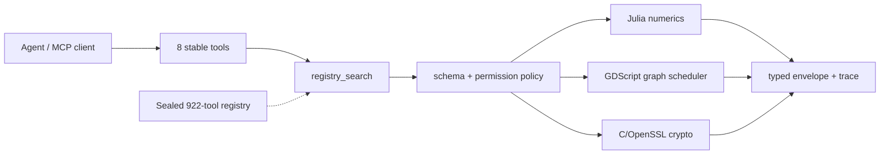

# Sovereign Agent Tool Runtime

<div align="center">

[](LICENSE)
[](test/run-tests.sh)
[]()
[]()
[](agda/)
[]()

**Eight stable MCP tools over a sealed 922-tool registry · Julia · GDScript · native crypto · Agda**


</div>

An agent execution environment that replaces IPython: tools are discovered once, sealed into a registry, and reached through eight stable MCP tools — while computation runs on Julia (numerics), GDScript (graph scheduling), and native C/OpenSSL (cryptography). No Python, no JavaScript.

```
AGENT → 8 tools → registry candidates → schema validation
      → permission policy → backend → typed result + trace
```

## Topics

`sovereign-agent` `mcp` `tool-registry` `julia` `gdscript` `openssl` `agda` `rust` `agent-runtime` `sealed-registry`


## Video

[](https://www.youtube.com/watch?v=kqkb-pm0FYA)

*Background on the Model Context Protocol that this runtime implements as a stdio MCP server.*

## The eight tools

| Tool | What it does |
| --- | --- |
| `registry_search` | Keyword search over the sealed registry (name/category/provider scoring + tier tiebreak). Returns candidates, never executes. |
| `registry_describe` | Full schema and metadata for a single registered tool. |
| `registry_status` | Registry health, counts, and evidence tiers. |
| `registry_verify` | Recompute and check the sealed registry integrity. |
| `compute_execute` | Run a numeric operation (array, matrix, tensor) on the persistent Julia worker. |
| `compute_inspect` | Inspect a named Julia session or intermediate result. |
| `graph_execute` | Schedule and run a directed acyclic graph via the GDScript/Godot scheduler (Kahn, cycle refusal). |
| `tool_execute` | Execute a registered capability through the permission-policy gate and the appropriate backend. |

Everything else — 922 registered tools across 93 providers — stays behind these eight and never enters the agent’s context (≈95 K tokens not loaded).

## How it works

1. **Discovery (once).** The Tool Discovery Engine ingests inventories into a sealed registry (`tools.jsonl`, 922 records after dedupe). This runtime loads it at start.
2. **Surface.** The agent sees only the eight MCP tools above (stdio JSON-RPC).
3. **Routing.** `registry_search` returns ranked candidates by deterministic keyword score. Similarity never authorizes.
4. **Gates.** Every call passes schema validation, then the permission policy (`policy.json`, default-deny on external_service, file_write, network, credentials, destructive).
5. **Backend.** 
   - Numerics → persistent Julia worker (`backends/compute.jl`) with session isolation and residual self-checks.
   - Graphs → GDScript scheduler (`backends/graph_runner.gd`) that refuses cycles.
   - Crypto → native C/OpenSSL (`backends/crypto.c`) covering AES-GCM, HMAC, Ed25519, etc.
6. **Result.** Typed envelope + verification status + trace. Invalid inputs, unauthorized ops, and timeouts are refused cleanly.

Formal invariants live in `agda/` (Runtime.agda, Topo.agda) and typecheck under `--safe`.

## Metrics (measured 2026-11-07)

| Metric | Value |
| --- | --- |
| Providers | 93 |
| Registered tools (after dedupe) | 922 |
| Verified tools (T1+T2) | 50 |
| Live callable ops | 23 compute/graph/crypto + 8 runtime tools |
| Test suite | 27/27 |
| Routing accuracy (12-task set) | top-1 8/12, top-3 10/12 |
| Search latency | 1.35 ms mean |
| Context tokens saved | ≈ 95 500 |
| Registry size on disk | 385 519 bytes |

Full numbers and method: [METRICS.md](METRICS.md). Coverage and limits: [STATUS.md](STATUS.md).

## Run it

```sh
cargo build --release
gcc -O2 -o cryptool backends/crypto.c -lcrypto
SAT_REGISTRY=../tool-discovery-engine/registry \
SAT_JULIA=julia SAT_GODOT=godot SAT_CRYPTO=./cryptool \
  ./target/release/sat-runtime          # MCP over stdio
```

Drive it with any MCP client, or the bundled one:

```sh
./target/release/sat-client ./target/release/sat-runtime scenario.jsonl
```

Verify:

```sh
test/run-tests.sh     # 27 checks, all backends live
```

## Architecture



## Repository layout

```
.
├── agda/               # formal invariants (Runtime, Topo)
├── assets/             # photos
├── backends/           # compute.jl, graph_runner.gd, crypto.c
├── data/               # exported registry products
├── docs/               # adapter and restricted-deployment notes
├── examples/           # MCP client config
├── src/                # Rust MCP server and client
├── test/               # 27-check suite
├── METRICS.md
├── STATUS.md
└── README.md
```

## License

SNAPKITTY OPAQUE SOURCE LICENSE v1.0 — see `LICENSE`.

---

<div align="center">

**SnapKitty Research Lab** · Bel esprit D'accord Trust

*Eight tools. Sealed registry. Owned backends. No Python. No JavaScript.*

</div>
